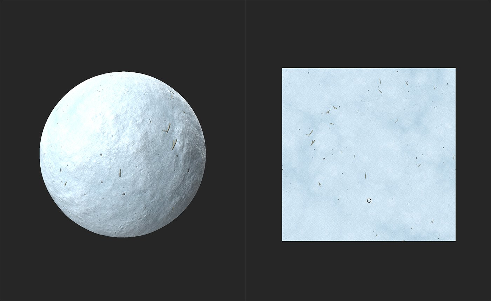

# 仿制图章

<table>
<tr style="border: 0;">
<td width="41.60%" style="border: 0;" valign="top">

**在：**&#x200B;个工具中

</td>
<td width="58.30%" style="border: 0;" valign="top">

## 描述

**仿制图章**&#x200B;工具可让您手动复制或修补材料的各个部分。 它主要用于修复接缝并从扫描材料中移除错误，例如碎片、阴影或伪像。 您可以在单个仿制图章图层内从不同的源区域绘画多个图章描边，并在&#x200B;**图层面板**&#x200B;中分别管理每个图章。

以下图像显示了正在使用&#x200B;**仿制图章**&#x200B;从雪材料中清除碎片。

雪的材料包括散布在周围的一些树枝和其他碎屑。

使用&#x200B;**仿制图章**&#x200B;工具后，小树枝被替换为干净的雪。

</td>
</tr>
</table>

## 参数

**基本参数**

* **展开蒙版**： 0-1

  调整滤镜将尝试匹配下层材料的绘画区域周围的距离。

* **渐隐混合**： 0-1

  柔化仿制区域的边缘，以与周围材料更自然地融合。

* **模糊蒙版**： 0-1

  调整仿制图章上的边缘细节量。 值越高，边缘越平滑，看起来像斑点。

* **保持比例**：切换

  禁用后，您可以单独调整图章区域的水平和垂直比例。

  * **水平**： 0-2
  * **垂直**： 0-2
* **旋转**： -180到180

  旋转盖章区域以匹配周围材料的方向或颗粒。

* **水平翻转**：切换

  沿水平轴镜像压印区域。

* **垂直翻转**：切换

  沿垂直轴镜像压印区域。

**渐隐混合**

使用每声道渐隐混合控件可单独调整每个材料声道的混合强度。

**高级**

* **正常强度**： 0-2

  在盖印区域中调整法线图的强度，以控制仿制表面对光照的响应方式。

* **源位置**：
  * 水平：0-1 — 调整仿制源的水平位置。
  * 垂直：0-1 — 调整仿制源的垂直位置。
* **目标位置**：
  * 水平：0-1 — 调整绘画目标的水平位置。
  * 垂直：0-1 — 调整绘画目标的垂直位置。
* **拼贴模式**：下拉菜单

  在材料边框附近克隆时启用或禁用拼贴。

## 如何使用仿制图章

1. 单击左侧边栏中的&#x200B;**仿制图章**，或通过&#x200B;**图层面板**&#x200B;中的&#x200B;**添加图层**&#x200B;按钮添加图章。 新的仿制图章图层将出现在图层堆叠顶部，并且&#x200B;**2D 视图**&#x200B;自动打开。

1. **设置源点**：按住`Ctrl` （`Cmd`，在macOS上）并单击&#x200B;**2D 视图**&#x200B;中材料的空白区域。 这将定义要复制的区域。

   > 📸屏幕截图[ID：clone-stamp-001]
   > 显示：在雪材料的干净区域可看到源点十字线的2D视口
   > 状态：已选择仿制图章图层；按住Ctrl键；显示源指示器
   > 批注：标记源十字线

1. **在问题区域**&#x200B;上绘画：单击并拖动要修复的区域。 源点的材料会实时替换绘制的区域。

   {width="300px"}

1. 在&#x200B;**属性面板**&#x200B;中调整&#x200B;**渐隐混合**&#x200B;和&#x200B;**扩展蒙版**，以微调克隆区域与其环境的混合方式。

>[!NOTE]
>
> 避免将源点放在要仿制的区域附近。 如果源与问题区域重叠，则可以将伪像与干净内容一起克隆。

## 使用多个源

您可以在单个仿制图章图层中添加多个源点，每个源点都有自己的位置、旋转和混合设置。 这允许您修复多个不同的区域（或从多个不同的干净区域绘制），而无需栈叠多个图层。

要添加新源，请按住`Ctrl` （`Cmd`在macOS上）并单击&#x200B;**2D 视图**&#x200B;中的新区域。 在&#x200B;**“图层”面板**&#x200B;中，仿制图章图层下方将显示一个新的图章条目。

> 📸屏幕截图[ID：clone-stamp-002]
> 显示：展开“仿制图章”图层的“图层”面板，显示嵌套在其下方的三个单独的图章条目
> 状态：仿制图章图层已展开；三个图章在不同源位置可见
> 批注：指向“图层”面板中嵌套的图章条目的箭头

在&#x200B;**图层面板**&#x200B;中选择任何单个图章项，以在&#x200B;**属性面板**&#x200B;中单独调整其参数，包括其源位置、旋转和混合设置。

>[!TIP]
>
> 使用&#x200B;**2D 视图**&#x200B;中的&#x200B;**画笔预览**&#x200B;在提交描边之前查看图章结果。 这可以帮助您在绘画之前验证源区域是否与周围区域匹配。

## 工具栏

<table>
<tr style="border: 0;">
<td width="16.67%" style="border: 0;" valign="top">

</td>
<td width="83.33%" style="border: 0;" valign="top">

选择仿制图章图层时，**2D 视图**&#x200B;中会显示一个工具栏。

* 选择&#x200B;**画笔工具**&#x200B;以添加到蒙版。
* 选择要从蒙版中移除的&#x200B;**擦除工具**。
* 设置当前所选工具的大小。
* 访问其他控件：
  * **画笔拼贴**：切换X和Y画笔拼贴。
  * **叠加**：将鼠标悬停在2D 视图上时，切换叠加可见性。
* 查看&#x200B;**2D 视图**。

</td>
</tr>
</table>

>[!NOTE]
>
> 与其他视口工具栏一样，您可以拖动工具栏顶部的手柄以重新定位它，双击手柄在垂直和水平布局之间切换，或使用双V形来隐藏或扩展它。

## Shortcuts

| 操作 | Windows + Linux | macOS |
| --- | --- | --- |
| 增加画笔大小 | `]`或`Ctrl` +鼠标滚轮 | `]`或`Cmd` +鼠标滚轮 |
| 减小画笔大小 | `[`或`Ctrl` +鼠标滚轮 | `[`或`Cmd` +鼠标滚轮 |
| 设置源 | `Ctrl` +左键单击 | `Cmd` +左键单击 |

## 相关

* [变形](./warp.md)
* [使其平铺](./make-it-tile.md)
* [图像到材质](./image-to-material.md)
