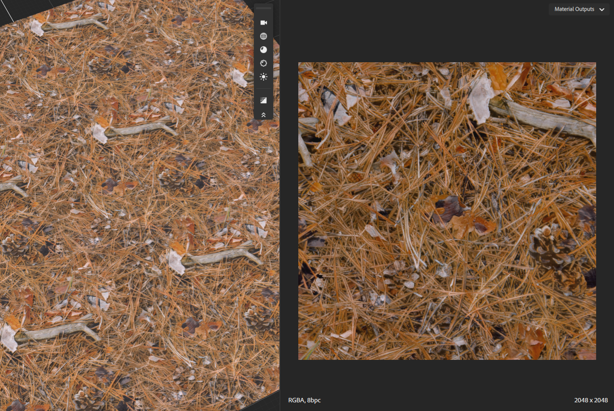

# 内容识别填充

<table>
  <tr>
    <td> <strong>在：</strong>个工具中</td>
    <td>通过描述 内容识别填充，可从材料中无缝移除Dirt、文本或其他不需要的对象。 在下面的森林地面示例中，木棍以重复图案脱颖而出。 通过“内容识别填充”，我们可以移除细枝，使重复变得不那么明显。    <em>移除前</em>   <em>移除后</em></td>
  </tr>
</table>

## 参数

* **通道选择：**&#x200B;选择要对其运行滤镜的通道。 默认情况下，此选项设置为所有声道；但是，您也可以选择仅在Height或Base color声道上运行。
* **镜像：**&#x200B;对于对称材料或图案，此设置将引导内容识别填充在材料中结合镜像内容。
* **缩放：**&#x200B;对于拼贴或砖块等几何图案，此设置可帮助保持图案的结构。

### 技术参数

* **自定义蒙版：**&#x200B;使用纹理应用蒙版，或使用画笔在&#x200B;**2D视口**&#x200B;中绘画您自己的蒙版。
* **搜索裁剪因子：**&#x200B;裁剪筛选器使用的样本区域。 默认情况下，采样区域覆盖除蒙版区域之外的整个纹理 — 增加&#x200B;**搜索裁剪因子**&#x200B;会减小采样区域，这有助于将采样限制为更接近蒙版区域的像素。

### 填充设置

* **颜色适应：**&#x200B;调整填充尝试适应周围颜色的程度。 此设置对于符合以下条件的材料非常有用
* **旋转适应：**&#x200B;对于元素旋转很重要的图案，例如花瓣或轮辐，此设置有助于创建更一致的结果。