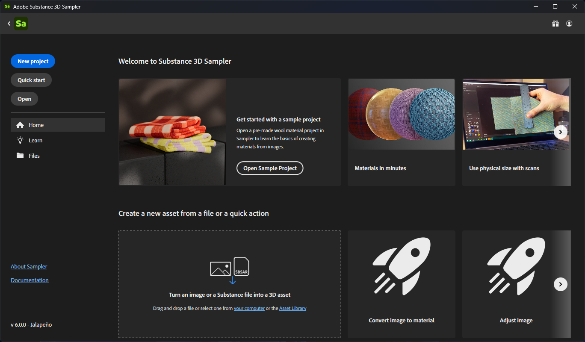

# 快速入门

当您打开Sampler时，将显示&#x200B;**主屏幕**。 **主屏幕**&#x200B;提供了许多选项，可帮助您开始使用新的或现有的Sampler项目。

1. **新建项目**：通过导入文件并从一系列快速操作中进行选择来创建新项目。
1. **快速入门**：创建一个新的空项目。
1. **打开**：使用系统的文件浏览器打开项目。
1. **主页**：访问推荐的教程、创建新项目或查看最近项目的列表。
1. **学习**：访问Sampler的视频教程和学习内容。
1. **文件**：查看最近打开的项目列表。
1. **关于Sampler**：了解有关您的3D Sampler版本的更多信息。
1. **文档**：查看文档并扩展您的能力。

当您打开、启动新项目或使用[快速操作](../features-and-workflows/quick-actions.md)时，**主屏幕**&#x200B;将消失，因此您可以开始创建资源。 您可以从&#x200B;**文件菜单**&#x200B;中再次打开&#x200B;**主屏幕**。

## 快速入门

要开始使用Substance 3D Sampler，请查看以下页面：

* [激活和许可证](activation-and-licenses.md)
* [系统要求](system-requirements.md)
* [性能模式](../technical-support/performance-mode.md)
* [Shortcuts](shortcuts.md)
* [正在导入资源](importing-resources.md)
* [快速操作](../features-and-workflows/quick-actions.md)
* [报告错误](report-a-bug.md)
* [项目管理](project-management.md)
* [导出](../getting-started/export/export.md)
