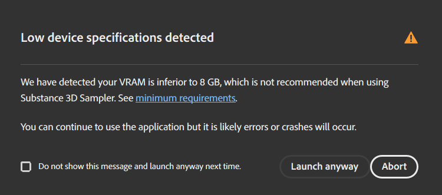

# 低规格模式

如果您的硬件不满足Sampler的[最低要求](../getting-started/system-requirements.md)，Sampler将自动以低规范模式启动，其行为类似[性能模式](performance-mode.md)，并且没有更改设置的选项。

## 低规格模式限制

低规范模式自动打开&#x200B;**性能模式**，所有功能均被禁用，最大预览分辨率为2048×2048。

低规格模式禁用：

* **位移**
* **阴影**
* **路径跟踪**

此外，低规格模式会阻止导出超过2048像素×2048像素。

*此消息在&#x200B;**低规范模式**下出现在&#x200B;**导出窗口**中，以提供额外信息。*

## 如何判断是否已启用低规格模式？

启动Sampler时，如果您的硬件不满足最低要求，则会出现一个窗口，指示未满足哪些要求，并为您提供了继续启动Sampler的选项。

下图显示了VRAM容量小于8GB的计算机示例。

如果选择&#x200B;**仍然启动**，则Sampler将在&#x200B;**低规范模式**&#x200B;中启动。 如果您已使用上述消息中的复选框无论如何都不会显示和启动，则在后续启动时仍会看到以下横幅。

最后，虽然启用了&#x200B;**低规范模式**，但无法关闭性能模式或调整性能模式设置。

