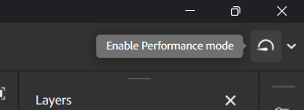

# 性能模式

性能模式汇集了所有可能会减慢工作流程的设置：分辨率限制、阴影、位移质量和路径跟踪。 关闭不需要的功能，获得所需的响应能力，尤其是在较轻的硬件上。

>[!NOTE]
>
> 如果您的硬件不满足Sampler的[最低要求](../getting-started/system-requirements.md)，则Sampler将自动在[低规范模式](low-spec-mode.md)中启动，其行为方式与性能模式类似，没有更改设置的选项。

## 切换性能模式

可以使用&#x200B;**Sampler窗口**&#x200B;右上角的&#x200B;**“性能模式”按钮**&#x200B;来切换性能模式。

## 更改性能模式设置

使用&#x200B;**性能模式按钮**&#x200B;旁边的下拉菜单控制性能模式启用的限制。

| 设置 | 描述 |
| --- | --- |
| **最大预览分辨率** | 性能模式可降低预览分辨率以实现更快的渲染。 这不会更改导入资源或文档的分辨率，而会更改视口渲染器的品质。 |
| **禁用位移质量** | 启用此设置后，**性能模式**&#x200B;会将&#x200B;**位移质量值**&#x200B;锁定为0，从而在视口中禁用位移效果。 对于平滑材料（如瓷砖或精细织物），这具有最小的视觉冲击，但可以显着提高性能。 |
| **禁用阴影** | 网格和置入的材料可以强制转换阴影，以牺牲性能为代价创建更逼真的图像。 打开&#x200B;**禁用阴影**&#x200B;后，性能模式会禁用所有阴影处理，从而提升性能。 |
| **禁用路径跟踪** | 路径追踪是一种强大的渲染方法，可在光路通过场景反射时沿着光路进行渲染，从而创建逼真的渲染。 但是，路径跟踪代价高昂。 打开&#x200B;**“禁用路径跟踪”**&#x200B;后，“性能”模式将禁用在&#x200B;**3D视口**&#x200B;中打开路径跟踪的选项。 |

>[!NOTE]
>
> 可以从&#x200B;**3D视口工具栏**&#x200B;访问路径跟踪。
>
> 
>
> 如果未启用路径跟踪，则仅启用&#x200B;**禁用路径跟踪**&#x200B;而启用性能模式将不会产生任何效果。